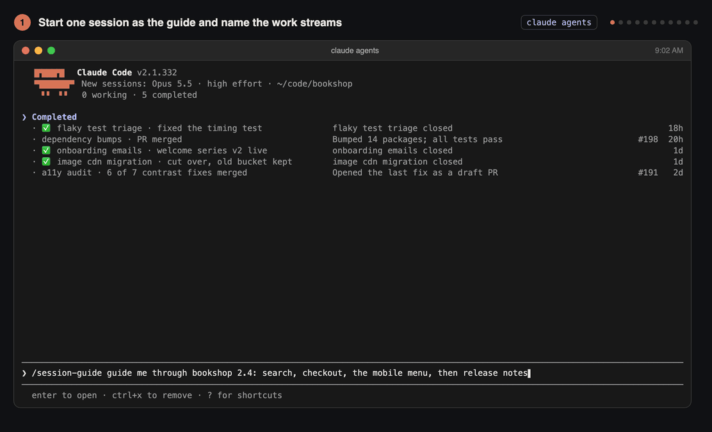
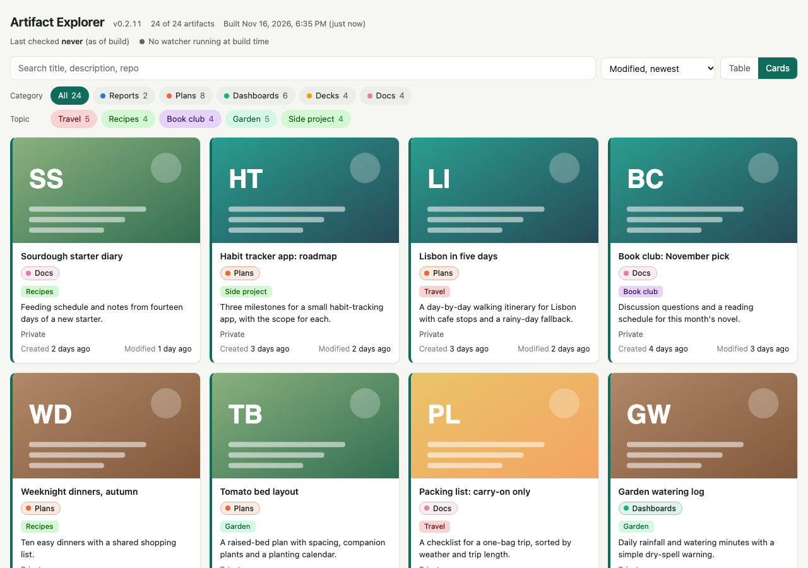

# jethro

[](https://github.com/jachai/jethro/actions/workflows/test.yml)
[](LICENSE)

Claude Code plugins for running many sessions at once. One repo, one marketplace, one plugin per folder.
Named after Jethro, who told Moses to stop judging every case himself and hand the work to others
(Exodus 18).

| Plugin | What it does | Folder |
|---|---|---|
| session-titles | Titles each session `<origin> · <focus>`: where it started, plus a few words for what it is doing now | [plugins/session-titles](plugins/session-titles) |
| session-sweep | Closes background sessions that are done, handed off or abandoned, after asking about the unclear ones | [plugins/session-sweep](plugins/session-sweep) |
| session-guide | Makes one session the guide across parallel sessions: one ledger, relayed decisions, handoffs | [plugins/session-guide](plugins/session-guide) |
| artifact-explorer | A catalog of your claude.ai artifacts on your own machine: one local page to search, sort and reopen everything you made or were sent | [plugins/artifact-explorer](plugins/artifact-explorer) |
| fancy-questions | Turns open questions for one decider into a one-card-at-a-time claude.ai artifact, then collects the answers | [plugins/fancy-questions](plugins/fancy-questions) |
| jethro | Installs the five plugins above | [plugins/jethro](plugins/jethro) |

The examples below use made-up sessions and invented data.

## The plugins

### session-titles

Keeps every session titled `<origin> · <focus>`: the name it started with, which stays put, plus a few
plain words for what it is doing now, refreshed on every prompt by a small model. You see it in
`claude agents`, in `/resume` and in the terminal tab.

```
  > Build a CSV export for the invoices page      invoice csv export  (first prompt: origin only)
  > tests pass? then open a PR                    invoice csv export · opening the pull request
  > watch CI and tell me when it's green          invoice csv export · PR 214 waiting on CI
```

More: [plugins/session-titles/README.md](plugins/session-titles/README.md)

### session-sweep

Closes the background sessions you have moved on from: ones that handed off to a newer session, ones
finished a day ago, and (after asking you) ones left waiting on an answer you will never give. It runs
on demand and every 12 hours, and closing can be undone.

```
$ session-sweep scan --all
CLOSE      c9d0e1f2 done        2d  flaky test triage        completed, idle 2d
CLOSE      a1b2c3d4 blocked    30h  billing export wave 2    handed off: e5f6a7b8 started from its handoff prompt
ASK→close  f7a8b9c0 blocked    12d  cache migration plan     waiting on you 12d: should I drop the old cache table now?
KEEP       e5f6a7b8 working    12m  billing export wave 3    working

2 to close, 1 to ask about, 1 to keep
```

More: [plugins/session-sweep/README.md](plugins/session-sweep/README.md)

### session-guide

Turns one session into the guide for your parallel sessions. It reads what every worker last said,
routes their questions to you as one interview, relays your rulings back, wakes itself while CI runs,
and tells you which session needs you and for what. It keeps one pinned title so you can find it:

```
🟥🟥 Sessions Manager · release-guide (2 managed · 1 watched · 3 active · 1 new) 🟥🟥

**Needs you now**
1. Merge #142 (green, mergeable, no deploy running)
2. 'search reindex worker' [b5c6d7]: one refund rule to decide (below)
```

A day with the guide, in `claude agents`, the guide's own chat and [claude-top](https://github.com/jachai/claude-top)
(invented project and data):



More: [plugins/session-guide/README.md](plugins/session-guide/README.md)

### artifact-explorer

Keeps a catalog of your claude.ai artifacts on your own machine: one local page to search, sort and
reopen everything you made or were sent. A hook and a silent watcher keep it fresh, and a small
background model writes a one-line description for each artifact.



More: [plugins/artifact-explorer/README.md](plugins/artifact-explorer/README.md)

### fancy-questions

Turns a set of open questions for one decider (Ops, a PM, a customer) into a claude.ai artifact they
walk through one card at a time: the recommendation first, a visual per question, answers saved in the
artifact's shared db. `/fancy-questions:collect` reads the answers back. A session writes only the
question data (one card from the bundled `minimal` example below), and the bundled `qw` CLI checks it
and builds the page:

```
"question": "Should a late payment add a $25 fee?",
"recommend": "Yes, after a 5-day grace period.",
"example": "Invoice of $1,000 paid 8 days late: $25 fee under the recommendation, $0 today.",

$ bin/qw stats skills/build/examples/minimal
2 cards (+1 parts), about 2 min, 1 urgent · visuals bars 1, tree 1, beforeAfter 1
```

More: [plugins/fancy-questions/README.md](plugins/fancy-questions/README.md)

## Install

You need Claude Code with background sessions, and Python 3.9+ on macOS or Linux. These are terminal
tools: plugins with a `bin/` folder are not installed by claude.ai or Cowork.

### 1. Add the marketplace

In Claude Code:

```
/plugin marketplace add jachai/jethro
```

or from a shell: `claude plugin marketplace add jachai/jethro`.

### 2. Install

The whole suite:

```
/plugin install jethro@jethro
```

or any of the plugins on their own:

```
/plugin install session-titles@jethro
/plugin install session-sweep@jethro
/plugin install session-guide@jethro
/plugin install artifact-explorer@jethro
/plugin install fancy-questions@jethro
```

The shell form is the same with `claude plugin install`. `jethro@jethro` installs the five as
dependencies. While it is enabled, its members cannot be disabled one by one: to leave one out,
uninstall `jethro@jethro` and install the plugins you want by name.

Open a new Claude Code window afterwards. A session that is already running keeps the hooks and
version it started with.

### 3. What to allow

Installing registers each plugin's hooks and monitor; Claude Code shows them in `/plugin`. Nothing else
is changed on install. The rest is asked for the first time a plugin needs it:

| Plugin | What | Why | Where it goes |
|---|---|---|---|
| session-titles | `UserPromptSubmit` and `SessionStart` hooks (`scripts/session_titles.py hook`) | Set the title on every prompt | Registered by the plugin (`hooks/hooks.json`); nothing to add |
| session-titles | One small `claude -p` call per prompt, through your own login, on `haiku` by default | Writes the focus. With `haiku`, roughly 10 to 50 cents per 1,000 prompts; on a subscription it counts toward plan usage | Nothing to allow. Model and mode: `/plugin` → session-titles → configure |
| session-sweep | A scheduled job every 12 hours: launchd on macOS, a systemd user timer (or one cron line) on Linux, plus a `session-sweep` link in `~/.local/bin` | Closes CLOSE rows and starts one interview session for the unclear ones | Installed by the skill's first run, which tells you it did. `session-sweep schedule uninstall` turns it off for good |
| session-sweep | `claude rm <id>` | How a session gets closed (archived first, so it can be restored) | Auto mode may refuse it inside a session. The skill then hands you the command to run with `!`. The scheduled job runs outside Claude Code and isn't affected |
| session-guide | `UserPromptSubmit` and `SessionStart` hooks (`guide_title.py hook`) | Re-apply the guide's pinned title and the managed and watched markers | Registered by the plugin; nothing to add. The hook prints nothing in any other session |
| session-guide | `SendMessage` and `ListAgents` between your local sessions | How the guide and its workers talk | Nothing to allow. If you run a cost guard that caps messages to one agent, exempt messages to other top-level sessions |
| session-guide | `claude stop <id>` | Stops a worker that is stuck on a prompt | Optional. The guide hands you `! claude stop <id>` to run yourself; if you add an allow rule for it, keep each stop in a Bash call of its own |
| artifact-explorer | `Bash(sh "*/artifact-explorer/*/bin/ae" *)` and `Bash(sh */artifact-explorer/*/bin/ae *)` | Each `ae` call runs without a prompt, and the background describer can start | `permissions.allow` in `~/.claude/settings.json`. `/artifact-explorer:setup` offers to add both and writes them only on a yes |
| artifact-explorer | Artifact tool reads of your artifact list and your own artifacts | Builds the catalog and the descriptions | Asked in setup. claude.ai may show its own consent prompt. Artifacts others shared with you are read only when you run `/artifact-explorer:refresh` yourself |
| artifact-explorer | `PostToolUse` (Artifact) and `SessionStart` hooks, and a silent watcher monitor | Record each publish, read and open, and rebuild the page every `watch_interval` minutes (10 by default) | Registered by the plugin (`hooks/hooks.json`, `monitors/monitors.json`); nothing to add |
| artifact-explorer | Background describer runs, within `describe_daily_cap` ($1.00 a day by default) | Writes the missing descriptions | Options in `/config` (plugins). `browser_history` and `transcript_reads` are on and read locally; `chrome_screenshots` and `share_harvest` are off |
| fancy-questions | `Bash(sh *bin/qw *)` | Runs `qw` to check and build the page | Granted by the build skill itself (`allowed-tools`) while it runs; nothing to add. `qw` needs Node 20+ |
| fancy-questions | Publishing a new artifact with a shared db, and one test save and delete | The page saves the reader's answers | Asked by claude.ai when the skill publishes. Share the page with the reader as **Contributor**: a Viewer or Commenter cannot save |
| fancy-questions | Claude in Chrome (the `walkthrough-checker` agent) | Opens the published page to check it before it is called ready | Needs the Claude in Chrome extension; the extension asks for site access |

### 4. First run

- **session-titles**: nothing to do. The second prompt in a new session adds the focus.
- **session-sweep**: run `/session-sweep:close-stale-sessions` once (or ask "close stale sessions"). It
  shows what it would close, asks about the unclear ones and installs the 12-hour job.
- **session-guide**: in the session you want as the guide, run `/session-guide:session-guide` and name
  your streams. In each worker you want managed, run `/session-guide:session-guide join`.
- **artifact-explorer**: run `/artifact-explorer:setup`. It prints the version it runs and asks
  everything in one message: the two allow rules above, the first refresh and a one-row describer test.
  Then it opens the page. `/artifact-explorer:open` opens it again later.
- **fancy-questions**: nothing to set up. Run `/fancy-questions:build` (or "turn these questions into a
  walkthrough for Ops") when you have questions to ask.

### 5. Check it works

```
claude plugin list                 # each plugin shows "Status: ✔ enabled"
```

- session-titles: `session-titles doctor` (Claude's Bash tool has it on PATH) checks python, claude,
  the hook registration and one model call. `session-titles status` lists the titles set in the last 24 hours.
- session-sweep: `session-sweep status` shows the job, the last run and the current counts.
  `session-sweep scan` shows what it would do and changes nothing.
- session-guide: the guide's title turns to `🟥🟥 Sessions Manager · <ledger> (...) 🟥🟥`, and managed
  workers start with `🟧🟧 (g) `.
- artifact-explorer: the first step of `/artifact-explorer:setup` runs `ae doctor`. It prints the
  version this window runs, the installed version and the marketplace version, and says MISMATCH when
  they differ.
- fancy-questions: `/fancy-questions:build` and `/fancy-questions:collect` show up in the `/` menu.

### Update

Marketplaces other than Anthropic's do not auto-update unless you turn that on.

```
claude plugin marketplace update jethro
claude plugin update session-titles@jethro       # one per installed plugin
claude plugin update session-sweep@jethro
claude plugin update session-guide@jethro
claude plugin update artifact-explorer@jethro
claude plugin update fancy-questions@jethro
```

Then open a new window. Updating the marketplace alone does not move an installed plugin. Each plugin
has its own version, `CHANGELOG.md` and release tags (`<plugin>--v<version>`).

### Uninstall or roll back

```
claude plugin uninstall jethro@jethro            # the bundle; its five plugins stay installed
claude plugin prune                              # removes the auto-installed plugins nothing needs now (asks first; -y in a script)
claude plugin uninstall session-titles@jethro    # or one plugin by name
claude plugin marketplace remove jethro          # after the last plugin
```

Before you remove session-sweep, run `session-sweep schedule uninstall` so the 12-hour job goes too.
Titles already set stay as they are. artifact-explorer's catalog stays in
`~/.claude/plugins/data/artifact-explorer-jethro/`. The two allow rules stay in `settings.json` until
you delete them.

To pin an older version, install from a local clone checked out at a release tag (tags made since the
move to this repo, for example `session-guide--v0.1.19`):

```sh
claude plugin marketplace remove jethro
git clone --branch session-guide--v0.1.19 https://github.com/jachai/jethro jethro-pinned
claude plugin marketplace add ./jethro-pinned
claude plugin install session-guide@jethro
```

`claude plugin marketplace add jachai/jethro` goes back to the latest.

## Moving from the old repos

Each plugin used to have its own marketplace (`session-titles@session-titles` and so on). Those installs keep
working. To move, uninstall the old one first, then install `<plugin>@jethro`: with both enabled, Claude Code
drops one copy's hooks. Options are stored under the full id, so set them again after the move. If you used a
plugin's `install.sh`, run `./install.sh --uninstall` from that clone first.

## Related

[claude-top](https://github.com/jachai/claude-top) (`uv tool install claude-agents-top`), a live list of your
sessions, stays in its own repo.
