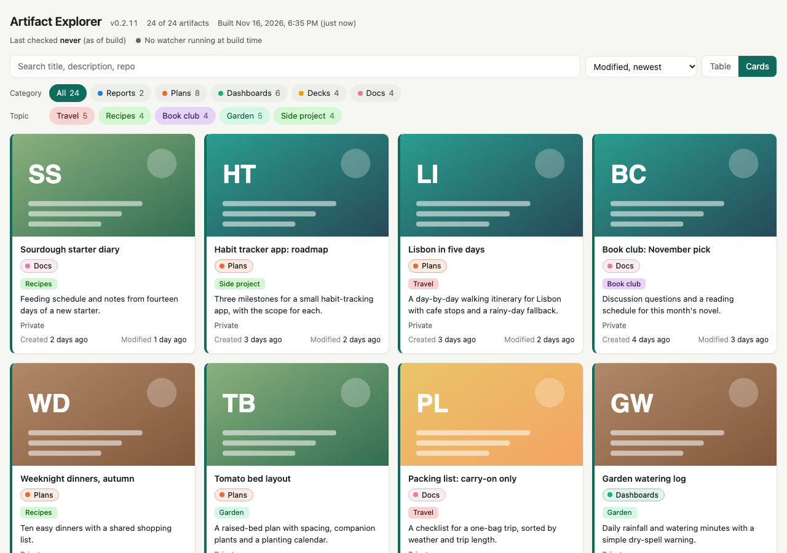
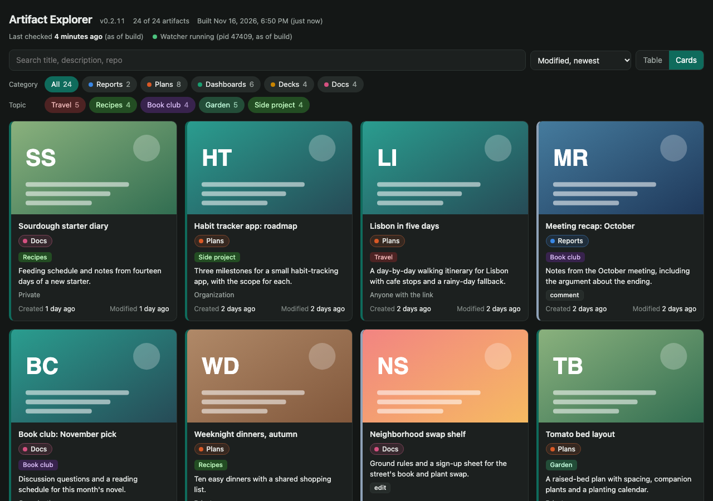
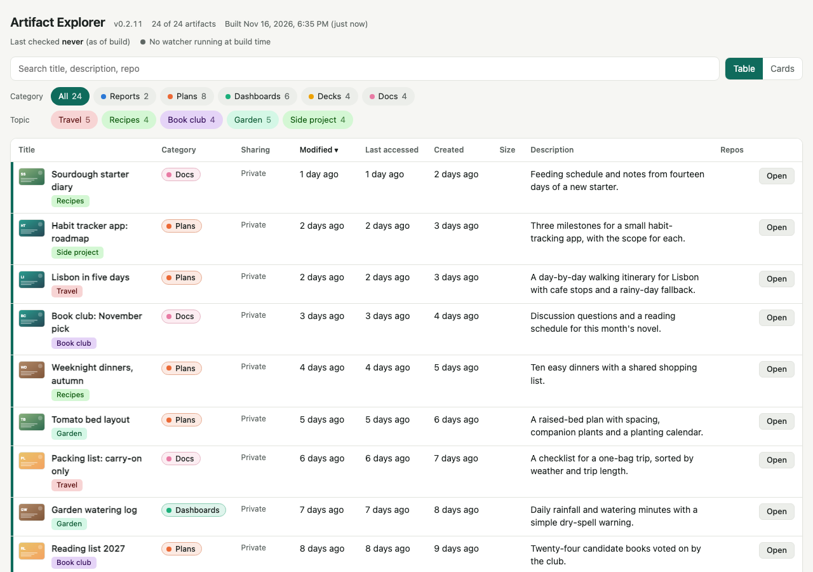

# Artifact Explorer

A Claude Code plugin that keeps a catalog of your claude.ai artifacts on your own machine. You get one local page to search, sort and reopen everything you made or were sent.

It stores a SQLite db, a `config.toml` and a static `explorer.html`. It needs Python 3.9+ and nothing else.

## Screenshots

Invented demo data (`python3 scripts/dev/demo_data.py DIR` writes the data and builds `DIR/explorer.html`).





## Install

```
/plugin marketplace add jachai/jethro
/plugin install artifact-explorer@jethro
/artifact-explorer:setup
```

Setup first prints the version it runs and whether your data folder is empty, then shows the options, writes `config.toml`, offers to import a catalog from the pre-plugin version, runs a first refresh, offers one permission rule (only written if you say yes; it says when the rule is already there), offers a one-row test of the background describer and opens the page. Run `/artifact-explorer:open` any time after.

## Update

```
claude plugin marketplace update jethro
claude plugin update artifact-explorer@jethro
```

Then open a new Claude Code window: a running session keeps the version it started with. Updating the marketplace alone does not move the installed plugin. the command below (or the first step of `/artifact-explorer:setup`) prints the version this window runs, the installed version and the marketplace version, and says MISMATCH when they differ.

```sh
sh ~/.claude/plugins/cache/"$(python3 -c 'import json,os,sys
p=os.path.expanduser("~/.claude/plugins/installed_plugins.json")
try:
    d=json.load(open(p))["plugins"]; k=sorted(k for k in d if k.startswith("artifact-explorer@"))[0]
    print(d[k][0]["installPath"].replace(chr(92),"/").split("/")[-3 if sys.argv[1]=="m" else -1])
except Exception: sys.exit("artifact-explorer is not listed in "+p+"; run: claude plugin install artifact-explorer@jethro")' m)"/artifact-explorer/"$(python3 -c 'import json,os,sys
p=os.path.expanduser("~/.claude/plugins/installed_plugins.json")
try:
    d=json.load(open(p))["plugins"]; k=sorted(k for k in d if k.startswith("artifact-explorer@"))[0]
    print(d[k][0]["installPath"].replace(chr(92),"/").split("/")[-3 if sys.argv[1]=="m" else -1])
except Exception: sys.exit("artifact-explorer is not listed in "+p+"; run: claude plugin install artifact-explorer@jethro")' v)"/bin/ae doctor
```

Do not use a `*` version glob there: old versions stay in the cache, and the glob expands to the oldest one first (0.1.2 on one machine). The command above takes the version folder from the `installPath` of the first `artifact-explorer@*` entry (any marketplace name works) in `~/.claude/plugins/installed_plugins.json` and prints an error if there is no such entry. It still matches the setup allow rule `Bash(sh */artifact-explorer/*/bin/ae *)`: the literal cache path supplies `/artifact-explorer/`, the resolved version folder fills the middle `*`, and `/bin/ae ` follows with a space.

## Moving from artifact-explorer@artifact-explorer

Artifact Explorer now lives in the [jethro](https://github.com/jachai/jethro) suite, so its install id is `artifact-explorer@jethro`. To move over:

1. `claude plugin uninstall artifact-explorer@artifact-explorer --keep-data`
2. `/plugin marketplace add jachai/jethro`, then `/plugin install artifact-explorer@jethro`

On its first run the new install copies the catalog (everything in the old `artifact-explorer-artifact-explorer` data folder except lock and wal files) into `artifact-explorer-jethro`; the old folder is left as it was. Options are saved under the full install id, but the plugin reads an options block under the old id when there is none under the new one, so you need not set them again. Every part of the plugin accepts any `artifact-explorer@*` id, so an install left on the old id keeps working too, but it no longer gets updates from the old repository.

## The page

- Every artifact has a category with a color (set `color` and `color_dark` on a `[[categories]]` entry to change it). The describer picks one category per artifact in the same call as its sentence. Rows without a description fall back to their kind, then to keywords, then "Uncategorized".
- Topics are automatic. The describer tags each artifact (up to three) and may suggest a topic; a suggestion shows as a normal topic pill straight away, and one used by at least `min_uses` artifacts across different title families is promoted to the Topic filter. Nothing waits for you. To steer it: define your own `[[topics]]` in `config.toml` (`name`, optional `keywords` matched on the title), rename one with `[topic_promote.rename]`, or hide one with `ae topics --hide NAME` (`--unhide NAME` brings it back). `ae topics` lists topics with counts. Topic pills filter the page like categories do, and a topic has the same color in the filter row, on cards and in the table.
- Your own artifacts show nothing about who made them. Someone else's shows "from <name>" (or "from another organization").
- A shared artifact shows its access: view, comment or edit. One that was in an earlier shared list and is missing from the latest complete one shows "No longer shared".
- Whenever a refresh reads an artifact someone else made, the page file is kept in `copies/` in the data folder (never your own artifacts, never published anywhere). A "No longer shared" row with a copy gets "Save local copy"; without one it says there is no copy.
- On a card only the thumbnail opens the artifact, so the title and text can be selected and copied; the table has an Open button on each row. Each artifact has its own window name, but claude.ai's cross-origin opener policy blocks reusing the tab, so each click opens a new tab.
- The header shows when the page was built and how long ago, and the version that built it. An artifact with no thumbnail gets a tile with its initials.
- The page has a favicon (a four-card grid in the accent color); `favicon.ico` is written next to `explorer.html`.

## Update check

At most once a day the build asks GitHub for the tags of `jachai/jethro` and takes the newest `artifact-explorer--vX.Y.Z`, caches the answer in `update.json` in the data folder, and shows "update vX available" with the update commands when it is newer than the running version. Offline or rate-limited means no badge and no error. Turn it off with `update_check = false` under `[page]` in `config.toml`. This is the only request the plugin makes outside your claude.ai account.

## Cost

Descriptions are written in batches of up to 8 artifacts per describer call, each saved before the next starts, up to 60 per run, by a background `claude -p` run on `haiku` (the `describe_model` option). Each run is limited to $0.15, $0.02 is booked against the daily cap when it starts, and the real cost replaces the booking when it ends. The default cap is $1.00 a day (`describe_daily_cap`); `ae status` shows today's spend. A run that ends without reporting its cost gives its booking back, and after two such runs in a day the describer waits for the next day. Without the setup permission rule no background run starts and nothing is spent; `/artifact-explorer:refresh` in a session describes on your normal usage.

## Options

Change them in `/config` (plugins).

- `watch_interval`: minutes between watcher passes (default 10, 2 to 240).
- `browser_history`: read a copy of your browser history for claude.ai artifact URLs (default on).
- `transcript_reads`: scan `~/.claude/projects` for Artifact tool calls (default on).
- `chrome_screenshots`: let `/artifact-explorer:screenshots` use Claude in Chrome for thumbnails (default off).
- `share_harvest`: let `/artifact-explorer:sharing` read the Share dialog of your artifacts in Chrome (default off).
- `describe_model`: model of the background describer session (default `haiku`). The `describer` agent itself always runs on `haiku`.
- `describe_stop_loss`: USD per saved row (default 0.01). A background run that saves no row, reaches 90% of its $0.15 limit, or costs more per saved row than this puts the watcher on a one-hour back-off.
- `describe_daily_cap`: USD per day for background describer runs (default 1.0). A run starts only when today's spend plus one run's $0.02 booking stays within it, and only one run goes at a time.

## Which artifacts get described

The first load covers only the newest 100 artifacts (`[window] first_load` in config.toml; `ae window --widen` lifts it). After that only a recent window, 60 days by default (`[window] days` in config.toml; `0` covers everything). Older rows sit in a collapsed "N older artifacts" group on the page. `/artifact-explorer:refresh older` widens the window by 30 days and describes them. Docs, Slides and Dashboard artifacts are described from their own source (the Doc's title and outline, the deck outline, the dashboard page and datasets). When that source cannot be read the title stands in, and `/artifact-explorer:refresh retry` tries again. Artifacts shared with you have no date in the list, so they count from the day the catalog first saw them.

## Permissions

Setup asks for everything once, in one message, and nothing afterwards:

- Two rules in `permissions.allow` of `~/.claude/settings.json`, so each `ae` call runs without a prompt and the background describer can start: `Bash(sh "*/artifact-explorer/*/bin/ae" *)` and `Bash(sh */artifact-explorer/*/bin/ae *)`.
- Reading your claude.ai artifact list and your own artifacts with the Artifact tool (claude.ai may show its own consent prompt).
- A one-row background describer test, and later background runs, within `describe_daily_cap`.
- The options in `/config` (plugins), and importing an older catalog when one exists.

Artifacts shared with you by others are never read in the background (claude.ai asks consent per read); they show "shared with you, not read" until you run `/artifact-explorer:refresh` yourself. The background run is allowed exactly the tools it uses (no ArtifactData), so it is never refused one.

## What leaves the machine

Only Claude's own calls: the Artifact list and read calls against your claude.ai account (plus ArtifactData and Claude Docs reads for Dashboards and Docs), and the describer model that writes one sentence per artifact. There is no telemetry. The one other request is the daily update check described above. Browser history and transcripts are read locally from copies, and only claude.ai artifact URLs and Artifact tool lines are kept.

## How it stays fresh

- A hook records every publish, read and open the moment it happens.
- A silent watcher (a plugin monitor) wakes every 30 seconds and runs one pass per `watch_interval` across all your sessions: history, transcripts, thumbnails, page rebuild, and a background describer run when something needs a description.
- `/artifact-explorer:refresh` reads your full artifact list and describes what is missing.

## Limits

- The watcher only runs while a Claude Code session is open (interactive or `claude --bg`, not `claude -p`).
- Reading an artifact someone else made always asks for consent. So background runs describe only your own artifacts. Shared ones wait for an interactive `/artifact-explorer:refresh`; SessionStart tells you when some are waiting.
- Browser history works on macOS, Linux and Windows for Chrome, Chromium, Edge, Brave, Arc, Vivaldi and Firefox.
- Thumbnails are made with a headless Chrome-family browser. Without one, the page draws a title card.
- Claude in Chrome may not be able to save screenshots to disk. The screenshots skill says so when it cannot.

## config.toml

It lives in the plugin data folder (`~/.claude/plugins/data/artifact-explorer-jethro/`; installs made under the old `artifact-explorer@artifact-explorer` id keep `artifact-explorer-artifact-explorer`). It sets the page title and accent, the columns, the categories (with colors), topics, the category rules, a filter (for example show only some repos) and per-artifact overrides (category, description, hidden). See [docs/design.md](docs/design.md) and the samples in [examples/](examples/), such as `examples/filter-by-repo.toml`.

## License

MIT. See [LICENSE](LICENSE).
