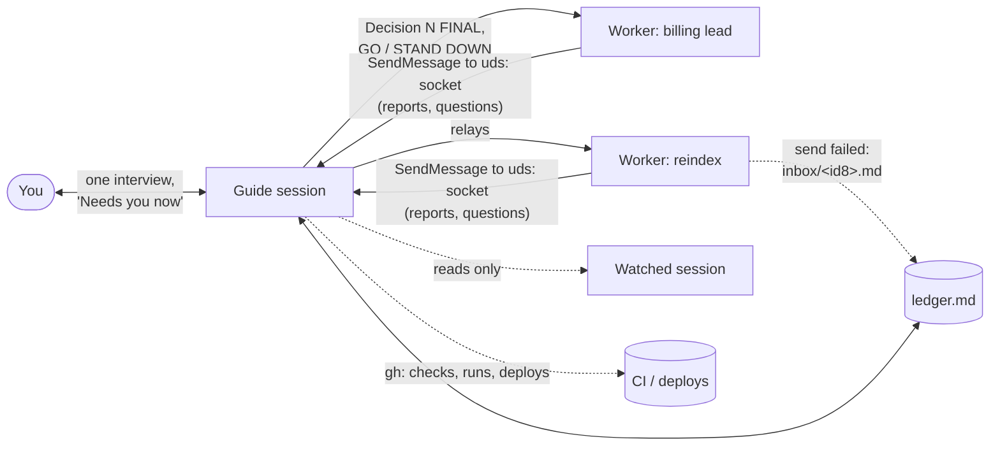

# How it works

## Roles

The guide never builds and never merges. Workers build. You decide and merge.

## A guide's turn

1. **Read what the hook put first.** On every guide prompt the title hook adds "Now: <local time and zone>" (the
   guide writes that time, never its own guess), the reconcile lines (below), the claims that need a look, and the
   audit's nags. They come from scripts, not from the guide's memory.
2. **Read the ledger.** It is the only state. Notes and status files are hints at best. `STATE.md` next to it is the
   scripts' few-KB digest of it (open sessions, reminders, results with no verdict, the audit's top rows), which is
   what a new guide reads first.
3. **Peek** at the 4–5 most active sessions (`peek.py`): last reply, any unanswered question, context size.
4. **Read CI**: PR checks, workflow runs, deploy jobs. One read per wake, never a watch loop.
5. **Decide.** Answer workers' questions from the Decisions list where possible. Batch the rest into one
   interview with you. Write the answers as numbered FINAL decisions and relay them, one message per worker.
   Every loose end a report raised ("not fixed", "out of scope", "FYI") becomes an Open items row with an owner;
   rows without one go into the same interview as a recommended owner + action, at most 4 at a time.
6. **Reply** to you in the "Needs you now / Streams / Proposed actions / Running on its own / Decision pending"
   shape. Every stream line ends with its next action and owner; every proposed action is a yes/no.
7. **Work the audit when nothing is due.** `guide_audit.py audit` ranks the work that is decided but not moving, or
   landed but not verified, and prints the top 10 rows with one next action each. A quiet wake proposes a start for
   each instead of sleeping; `set <key> started | asked | parked | done | dropped` records the outcome. A row with
   later evidence that it is done is kind `check`: the guide confirms it instead of asking you, and a daily read-only
   strike sweep clears such rows in bulk.
8. **Update the ledger** in place and schedule the next wake: +5 for imminent events, +10 for long runs, backing off
   when only you can unblock things.

## Reconcile: the ledger against what really happened

The ledger says MANAGED; the session may have ended minutes ago. `guide_reconcile.py` joins the two on every guide
prompt, in `settle`, first in `mark` and in `retire`. For each MANAGED or WATCHED row it reads the job folder
(`<config>/jobs/<id8>/state.json` and the tail of `timeline.jsonl`) and the live process list; only a flagged row
costs a transcript read. A job that ended more than 3 minutes ago is classified by its result line:

| Line | When | What the guide does |
|---|---|---|
| HANDED OFF | its result says HANDED OFF and no Sessions row is its successor | starts the successor now, without asking you |
| BLOCKED | its result says blocked / needs / waiting, and no Waiting row exists | answers it, or asks you and writes the reminder |
| ENDED | a MANAGED row ended any other way | records the result and closes it |
| UNDELIVERED | its last report never reached the guide (sent to a title, failed, or final text only) | reads it with peek and acts |
| INBOX | a worker wrote `inbox/<id8>.md` next to the ledger because its send failed | acts on it, then deletes the file |

A line has no memory: it comes back on every prompt until the row changes. "Handed off to the guide" passes a
deliverable on and is no handoff.

## Claims

A merge handed to you, or a command someone was asked to run, is a row in the ledger's Claims table
(`guide_title.py claim merge #N` / `claim run "<command>" --by <who>`). The hook re-checks merge claims with
`gh pr view --json state,mergedAt` (cached 10 minutes in `<config>/session-guide/gh-cache.json`, 5 s timeout, fails
open), closes the merged ones itself and says so once, and lists run claims with no evidence after 4 hours. Ledger
lines that say "MERGE READY #N", "<someone> runs / tells …" or hold a `!` command with no claim are counted, so a
merge nobody claimed is seen too.

## Decisions

A decision is written once and relayed verbatim. If you contradict an earlier decision, the old line is struck
through, not deleted, so a fresh guide can see what changed. When you answer a worker directly, the guide adopts the
answer, and asks you which ruling stands if it conflicts with an earlier one, before anyone builds on it.

## Handoffs

Workers hand off near their context limit with a resume prompt, sent by SendMessage to the guide's `uds:` socket
like every HANDED OFF, BLOCKED, DONE and MERGE READY report. The guide starts the successor with `guide_title.py
launch` and records it as MANAGED; if the guide missed the report, reconcile lists the handoff on its next prompt.

`launch` exists because a worker has to be marked guided early: a cost guard that reads the marker stops an unmarked
session's first tool call. `claude --bg` picks its own session id, so `launch` writes the marker the moment the id is
printed, while the worker's first model call is still in flight; a `--resume <id>` launch is marked before it runs. The guide itself prints its context size in every status reply and hands off at 120k: because the ledger
is current, the next guide needs one line, `/session-guide` + "Take over as guide. Ledger: <path>."

The guide it replaces is **retired**, not left hanging. The new guide runs `guide_title.py retire <old id>`, so the old
title turns to "🎟️🎟️ Sessions Manager (retired) 🎟️🎟️" and never goes red again. `retire` is a gate: it runs reconcile
and refuses while a row needs a guide, and `--force` writes those rows into the ledger's Handoff table instead. A
guide change never stops the workers' reports: the outgoing guide sends each worker one fixed line, "Guide changing.
Keep sending to this socket; the old guide forwards until the new one introduces itself.", and a retired guide's hook
tells it on every prompt to forward what reaches it to the new guide's socket and act on nothing. Then it asks the old guide for a
final message ending in a `result:` line, which turns that session's state to done instead of "needs input". It
checks the state, and marks the old guide's row RETIRED in the ledger. An outgoing guide that sees its successor
introduce itself retires itself the same way.

## Guided prefix

A MANAGED worker's title starts with "🟧🟧 (g) ", so the user can see which sessions don't need them. The marker is a
file next to the guide's own (`guides/<session id>`, holding `guided`), written by `guide_title.py guided`. On each
prompt the hook reads the session's current title and, when the prefix is missing, sets the same title with it in
front. When the prefix is already there it prints nothing, so a titling hook's focus update goes through untouched;
session-titles' answer overrides this hook's, so the prefix also goes into its stored origin, whenever a marker is
written and on every prompt. `unguided` flips the marker
to `unguided`: the hook strips the prefix on the next prompt, then deletes the marker. Guide and retired markers hold
a ledger path or `retired`, so they never get the prefix.

A WATCHED session works the same way with the marker `watched` and the prefix "⬜⬜ " (`guide_title.py watched`), so
a light gray row is a session the guide only reads. An ACTIVE session has the marker `active` and the prefix "🟦🟦 ":
running, but the guide neither reads nor messages it. Anything else that reads these markers must treat a keyword it
doesn't know as "not a guide": only a path is a guide.

## Sweeps and closing

On every prompt the guide gets, the title hook runs a sweep (`guide_title.py sweep`), reading transcripts directly. A
session active in the last 12 hours with no row in the ledger is new: the title shows the live count, and the list
goes to the guide with each prompt until every session on it has a row. That list can't drift and needs no other
tool. The guide keeps a wake scheduled while any session is active, because nothing wakes it when a session starts.

Everything the guide needs from you goes through `AskUserQuestion`, not text: new sessions (Manage / Watch / Leave
active / Ignore), decisions, approvals it can relay, and Done / Not yet for what only you can do. A WATCHED session that asks a question gets it put to the user, and the
answer relayed back in one message, its only one.

A MANAGED session that is finished or obsolete is closed, the way a guide is retired: `guide_title.py done <id>`
writes the marker `done`, so the hook swaps "🟧🟧 (g) " for "✅ " and never gives the session a guided, watched or guide title
again. The guide asks it for a final message with a `result:` line, checks its state shows done, and marks its row
DONE. A session stuck on a dialog can't read the message, so the user gets `! claude stop <id>` instead.

## Addressing sessions

Session titles change when sessions rename themselves. The guide replies to a worker's `from=` address when it has
one. Otherwise it re-reads `ListAgents` and uses the full current row name. A worker always sends to the guide's
`uds:` socket exactly as its brief gives it, never to the guide's title: a send to a title fails. Talking to you, it always uses the
title, with the short id in brackets.
